# Praktikum 6 — JavaScript DOM dan Event Handling

## Identitas Praktikum

- **Nama:** Mu’ammar Kadafi
- **NIM:** 312510192
- **Program Studi/Semester:** Teknik Informatika / 3
- **Mata Kuliah:** Pemrograman Web
- **Dosen Pengampu:** Agung Nugroho, S.Kom., M.Kom.
- **Kelas:** I253C
- **Hari/Tanggal:** Sabtu, 31 Oktober 2026
- **Pertemuan:** 7 (Online)

## Tujuan Praktikum

- Memahami DOM sebagai representasi dokumen HTML yang dapat diakses melalui JavaScript.
- Menggunakan id, class, dan selector CSS untuk memilih elemen HTML.
- Mengubah teks, atribut, kelas CSS, dan gaya elemen melalui JavaScript.
- Menangani event pengguna menggunakan addEventListener().
- Membuat validasi form dan menampilkan pesan sesuai kondisi input.
- Mengembangkan halaman interaktif dengan minimal tiga fungsi yang berjalan benar.

## Struktur

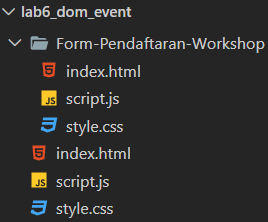

## Langkah-Langkah Praktikum

### 1. Mempersiapkan Text Editor

Mempersiapkan text editor yang akan digunakan untuk menulis kode program, misalnya Visual Studio Code.

### 2. Membuat Folder Kerja

Membuat folder kerja dengan nama ` lab6_dom_event` sebagai tempat menyimpan file praktikum.

### 3. Membuat File

Membuat file baru dengan nama `index.html`, `style.css` dan `script.js` di dalam folder kerja yang telah dibuat. Hubungkan file CSS dan JavaScript dari index.html.

### 4. Menuliskan kode

Pada file index.html, isi dengan kode berikut.

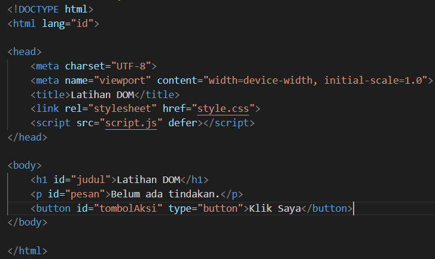

Pada file  script.js, isi dengan kode berikut.

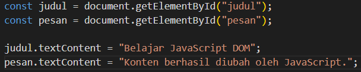

Tampilan akan terlihat seperti pada gambar berikut.

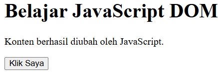

### 5. Event click

Saat tombol diklik, ubah teks paragraf dan tampilkan waktu saat tindakan dilakukan.

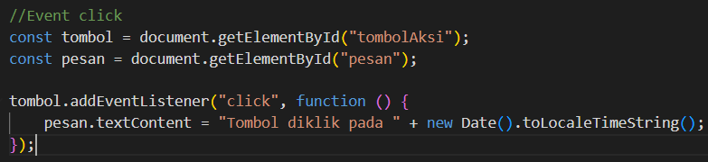

Tampilan akan terlihat seperti pada gambar berikut.

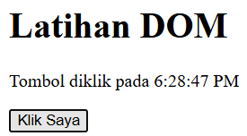

Tampilan setelah menekan tombol beberapa kali 

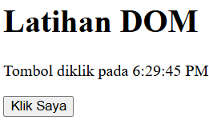

### 6. Mengubah kelas dan gaya CSS

Tambahkan aturan CSS berikut ke style.css dan buat paragraf id teksGaya serta tombol id tombolGaya. 

Tambahkan kode berikut pada index.html.

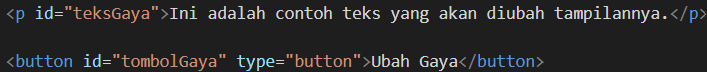

Tambahkan kode berikut pada style.css. 

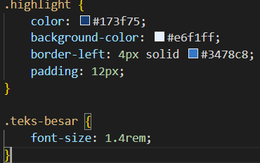

Tambahkan kode berikut pada script.js.

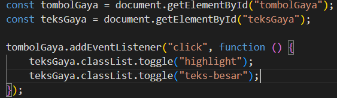

Tampilan akan terlihat seperti pada gambar berikut.

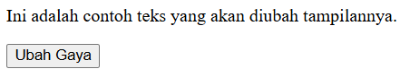

Tampilan setelah menekan tombol ubah gaya seperti gambar berikut. 

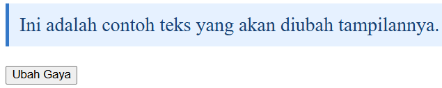

### 7. MengEvent input dan penghitung karakter

Buat input teks dan indikator jumlah karakter yang diperbarui saat pengguna mengetik.  

Tambahkan kode berikut pada index.html.

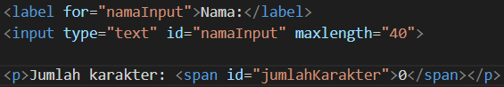

Tambahkan kode berikut pada script.js.

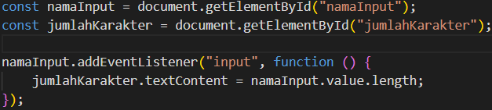

Tampilan akan terlihat seperti pada gambar berikut.

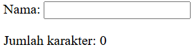

Tampilan sedang mengetik seperti pada gambar berikut.

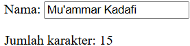

Tampilan sedang menghapus seperti pada gambar berikut.

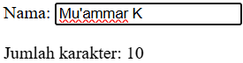

Tampilan sedang menempelkan teks seperti pada gambar berikut. 

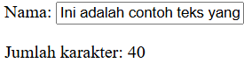

### 8. Validasi form pendaftaran 

Buat form nama, email, dan usia. Program menampilkan pesan jika input tidak sesuai.  

Tambahkan kode berikut pada index.html.

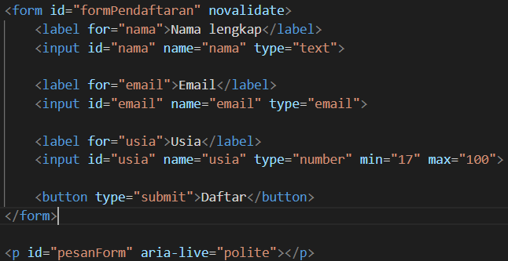

Tambahkan kode berikut pada script.js.

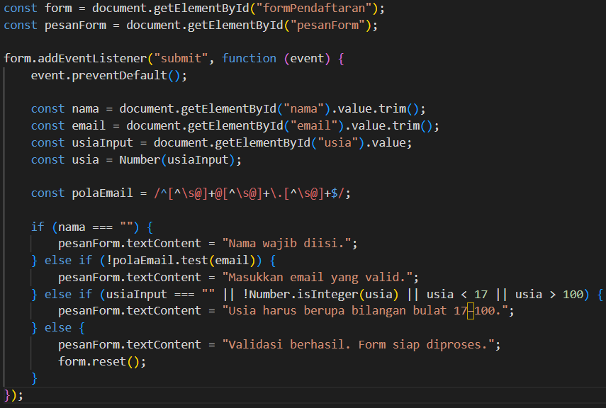

Tampilan tanpa mengisi data seperti pada gambar berikut. 

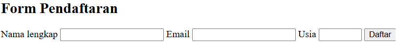

Tampilan kosongkan nama, kemudian isi email dan usia seperti pada gambar berikut.

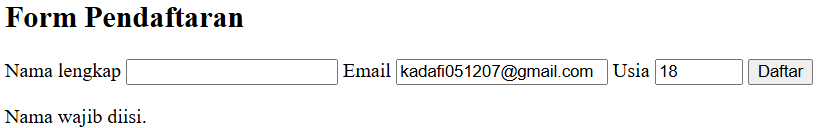

Tampilan masukkan email dengan format yang tidak valid seperti pada gambar berikut.

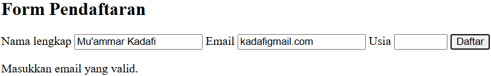

Tampilan masukkan usia di bawah 17 tahun seperti pada gambar berikut.

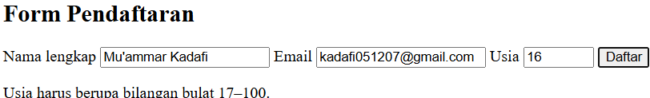

Tampilan masukkan data yang benar pada semua kolom seperti pada gambar berikut.

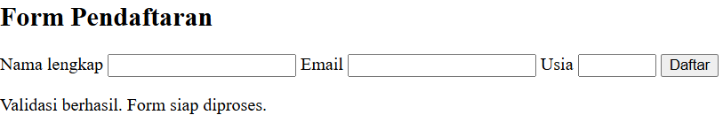

### 9. Daftar tugas sederhana (To-do List)  

Buat aplikasi kecil untuk menambahkan tugas dan menandai tugas selesai.  

Tambahkan kode berikut pada index.html.

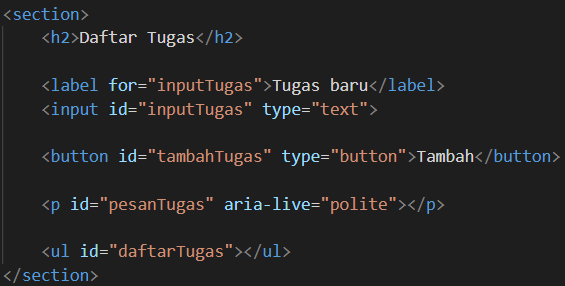

Tambahkan kode berikut pada script.js.

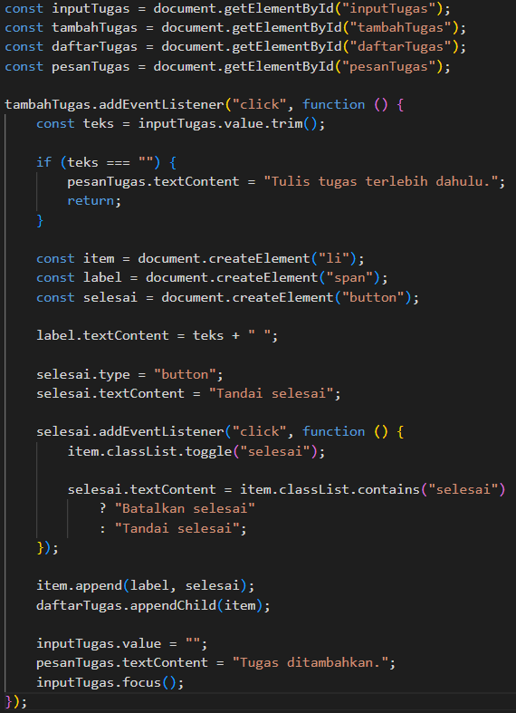

Tambahkan kode berikut pada style.css.

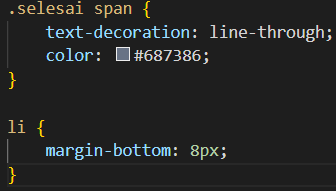

Tampilan akan terlihat seperti pada gambar berikut.

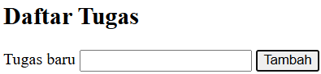

Tampilan kosongkan tugas baru seperti pada gambar berikut.

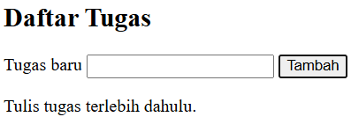

Tampilan masukkan tugas baru seperti pada gambar berikut.

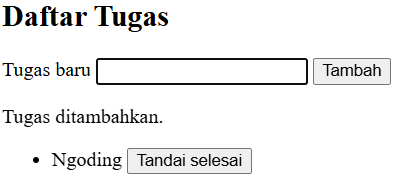

Tampilan menekan tombol tandai selesai seperti pada gambar berikut. 

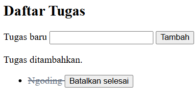

### 10. Mini Projek – Form Pendaftaran Workshop

Buat folder Form-Pendaftaran-Workshop baru di dalam folder lab6_dom_event. Buat file di `index.html`, `style.css`, dan `script.js`, yang mencakup berikut ini:

- Validasi nama, email, dan pilihan sesi.
- Penghitung karakter atau ringkasan input secara langsung.
- Pesan kesalahan dan pesan sukses yang tampil pada halaman.
- Tombol reset atau hapus input.Gunakan addEventListener() untuk event input, change, click, atau submit.

Tambahkan kode berikut pada index.html.

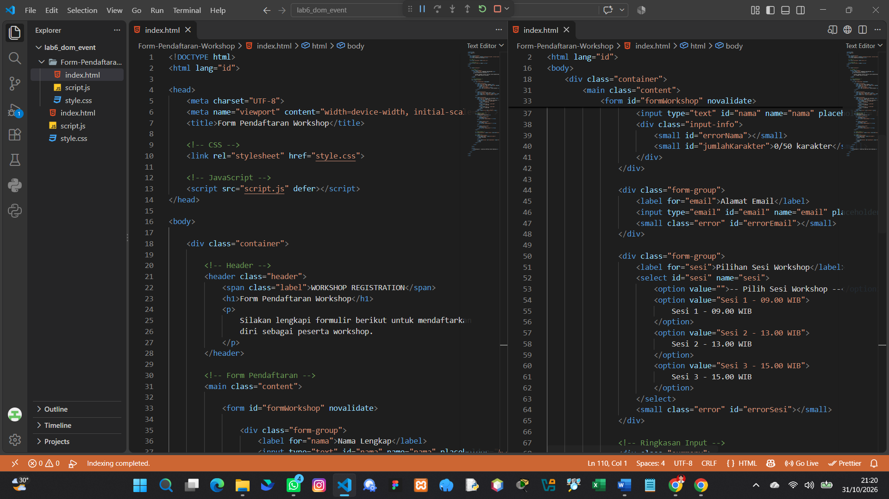

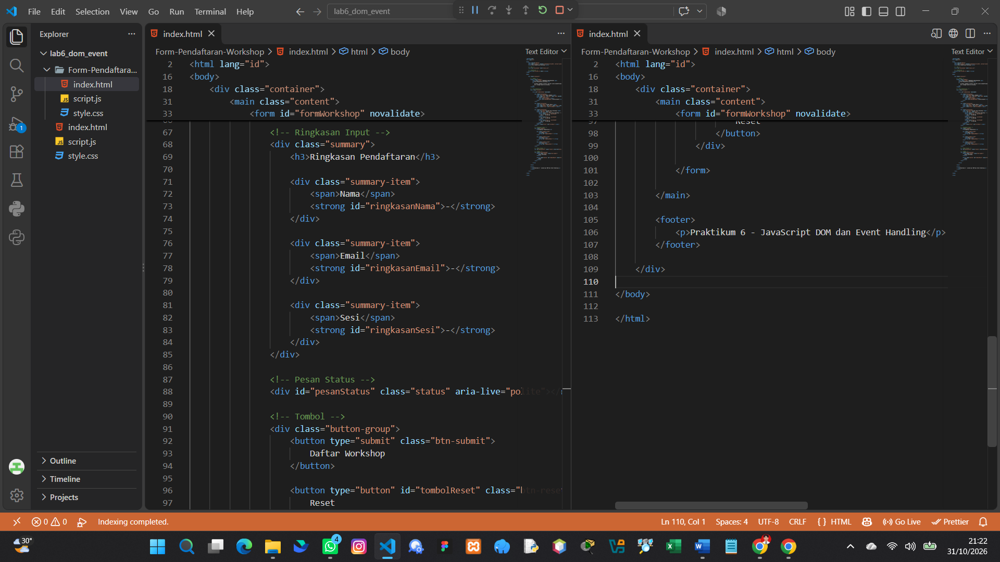

Tambahkan kode berikut pada style.css.

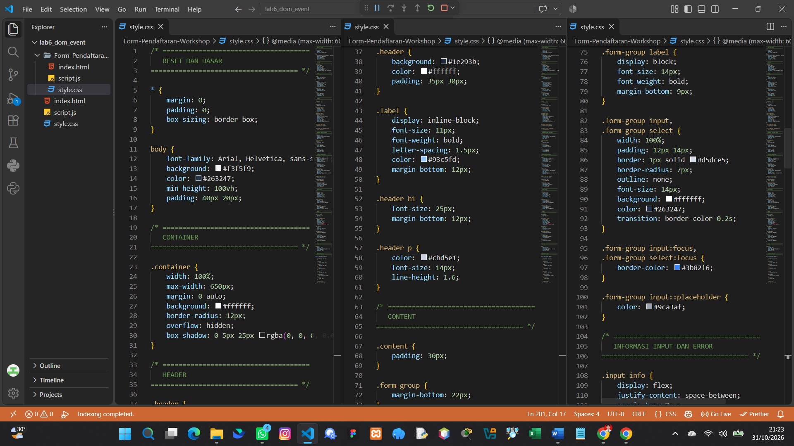

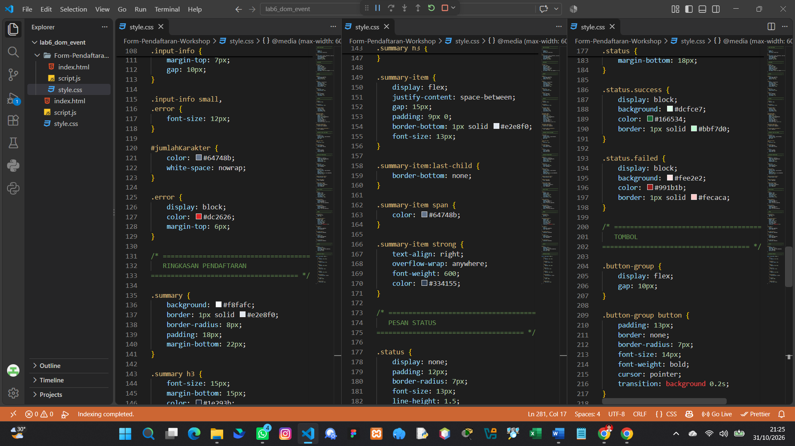

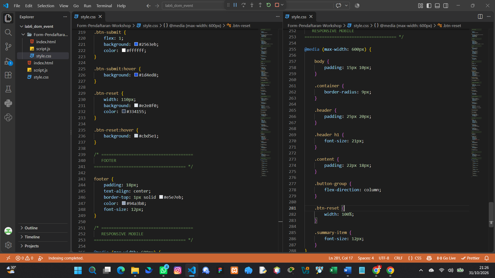

Tambahkan kode berikut pada script.js.

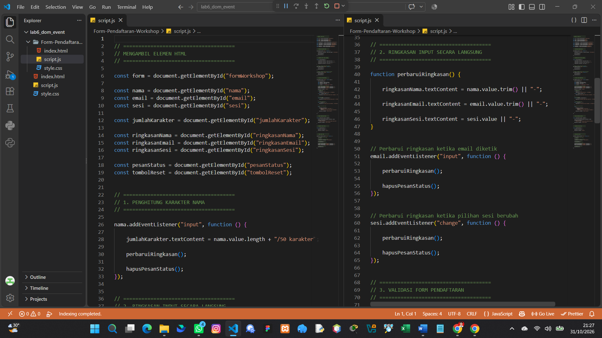

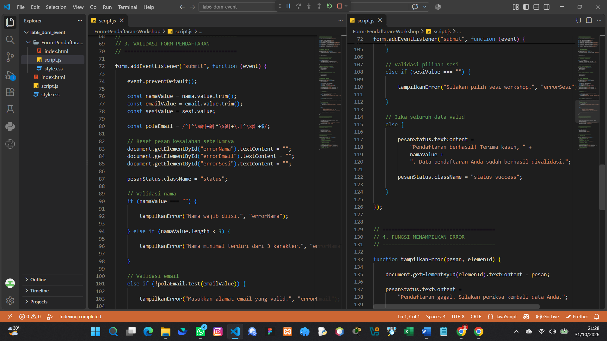

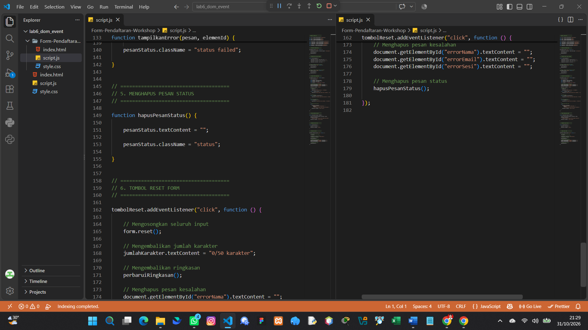

Tampilan akan terlihat seperti gambar berikut.

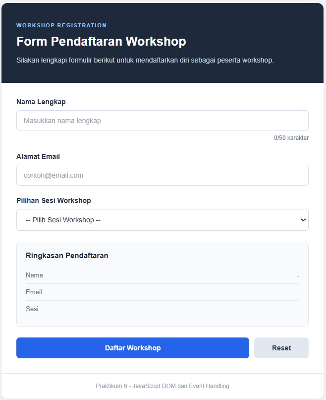

Tampilan gagal pendaftaran. 

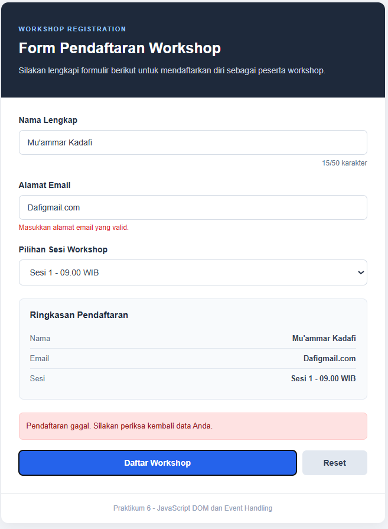

Tampilan berhasil pendaftaran.

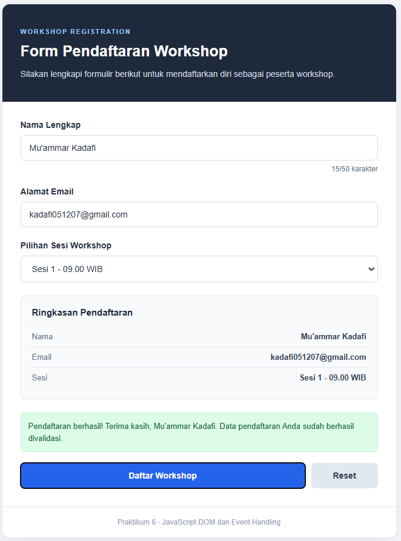
